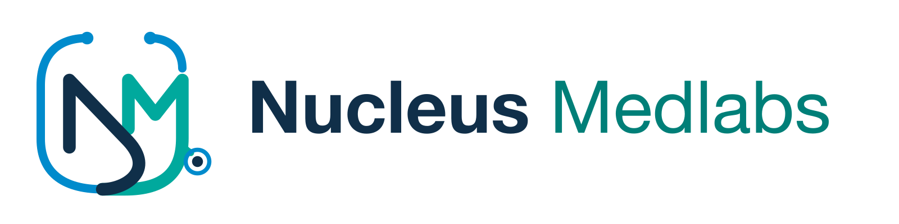

<p align="center"></p>

# CareerShift by Nucleus MedLabs

[](https://mohd-amir-ali.github.io/Nucleus-MedLabs/)
[](https://github.com/mohd-amir-ali/Nucleus-MedLabs/releases/latest)
[](https://github.com/mohd-amir-ali/Nucleus-MedLabs/actions/workflows/android-apk-build.yml)

A healthcare career planning workspace that connects professional experience to possible next steps. Explore 12 career directions from 14 professional starting points, understand your skill gaps, compare options, and take a printable plan into your next career conversation.

Version **8.6.0** is a client presentation release. The platform links above become available after the repository is published, Pages succeeds, and an Android release is created.

## What makes CareerShift useful

- Transparent readiness factors based on the profile and skills you enter.
- Side-by-side pathway comparisons with distinct colours and consistent criteria.
- Self-reported skill confirmations and five-phase learning roadmaps.
- Configurable LinkedIn searches instead of an invented vacancy feed.
- Learning topics with searches across provider catalogues.
- A personalised two-page A4 plan with circular completion markers.
- Twelve selected career and MedTech reads, with distinct cover images and saved articles.
- Consultation links to the official Nucleus MedLabs website.
- One shared application for browsers, installable web use, phones and Android tablets.

Readiness is an unvalidated planning estimate, not a hiring probability. Salary ranges and preparation timelines are illustrative. Courses and jobs must be verified with the provider or employer. The reading edition is bundled, not a daily live news service.

## Experience map

| Area | Available behaviour |
| --- | --- |
| Demonstration sign-in | Editable name, prefilled read-only credentials and password visibility |
| Home | Blended image carousel, saved progress, six explanatory feature dialogs |
| Profession and profile | Profession, qualification, experience and work setting |
| Responsibilities and interests | Select relevant experience and desired career directions |
| Matches | Ranked pathways with transparent factor breakdowns |
| Report overview | Readiness, key considerations and planning context |
| Skills | Current and transferable skills, remaining topics and completion state |
| Roadmap | Five phases with completion dates |
| Jobs | Editable keywords, location, experience, workplace, employment and date filters |
| Learning | Topic bookmarks and external provider catalogue searches |
| Compare | Up to three pathways in an accessible comparison table |
| Saved | Saved careers, learning topics and reading sources |
| Updates | Twelve cards from Nucleus MedLabs and authoritative health organisations |
| Settings | Theme, preferred city, backup/import, consultation link and reset |
| Career plan | Two-page PDF download on web; save/share on Android |
| Web presentation | Website, 820 x 1180 tablet and 390 x 844 smartphone viewports, with rotation |

The web presentation uses a real iframe viewport, so responsive layouts change correctly without restarting the application. Mobile browsers automatically use their available viewport. The APK opens the application directly without the website toolbar.

## Demonstration access and data

Email: `amirali@nml.com`  
Password: `nml@123`

These public demonstration values are prefilled in the interface. They do not protect private information and are not real account credentials. Enter your name to personalise the greeting and PDF.

The web application uses browser local storage. Android uses Capacitor Preferences. Each installation has one workspace, without cross-device synchronisation. Browser and APK storage are separate. Export a backup from Settings before uninstalling or clearing app data.

Supabase, cloud accounts, OTP, payments and a production database are not connected. An optional local Python pilot remains available for development; its SQLite data is never included in the public web build or Android package. See [Backend boundaries](docs/BACKEND.md).

## Run locally

Requirements: Node 22.22.2 or later within the supported Node 22/24 range, npm and Python 3.

```sh
npm ci
npm run bundle
npm run build
python3 -m http.server 8080 --bind 127.0.0.1 --directory dist
```

Open `http://localhost:8080`. The repository is source; serve `dist` rather than the whole source folder. HTTPS is needed for installation and demonstration verification on devices away from localhost. The optional `Start-Install-Preview.command` creates a temporary HTTPS preview through localhost.run; the final GitHub Pages address removes the need for a running Mac or temporary tunnel.

## Build and verify

```sh
npm test
npm run build
npm run audit:source
npx playwright install chromium
npm run test:ui
```

Checks cover scoring, stored data, authentication boundaries, UI journeys, external-search parameters, article validation, service-worker behaviour and two-page PDF layout across all profession/pathway combinations. Browser tests cover phone, tablet, landscape and website preview modes. See [Testing and device acceptance](docs/TESTING.md) for the limits of local verification.

## GitHub publication without Terminal

Use [the GitHub Desktop guide](docs/GITHUB_SETUP.md). Upload this source folder, not a ZIP or generated `dist` directory.

1. Publish `Nucleus-MedLabs-CareerShift` through GitHub Desktop.
2. Set Pages to use GitHub Actions.
3. Configure all four Android signing secrets for stable signed APK/AAB builds.
4. Push `main` to run checks and web/Android builds.
5. Run the Android workflow with **Publish release** enabled to expose the downloads under Releases.

The Pages workflow publishes only the allowlisted public bundle. The Android workflow generates the native project from pinned Capacitor packages, installs branded launcher resources, and compiles it with Java 21 and Android SDK 36. With signing secrets it produces a release APK and AAB; without them it produces a clearly labelled debug preview APK only.

APK files install directly on compatible Android devices. AAB files are intended for Play Console submission, not direct installation. A successful build is not Play Store approval. Keep the same signing identity for future APK updates. See [Signing](docs/ANDROID_SIGNING.md).

## Repository layout

| Path | Purpose |
| --- | --- |
| `index.html`, `styles/platform.css`, `scripts/web_platform.js` | Browser presentation and viewport controls |
| `app.html`, `styles/`, `scripts/` | Shared application and build utilities |
| `data/` | Career catalogue and curated reading edition |
| `Banner-Images/`, `assets/`, `Logo-Brandkit/`, `fonts/` | Used application assets and licences |
| `native/`, `capacitor.config.json` | Android bridge and wrapper configuration |
| `tests/` | Functional, data, PDF and browser checks |
| `.github/workflows/` | Checks, Pages and Android release automation |
| `docs/` | Publication, signing, security, testing and backend guidance |

Dependencies, generated native projects, private data, signing files and release binaries are not repository content. `package-lock.json` is committed so builds use the pinned dependency graph.

## Attribution and ownership

Project maintained by **Mohd Amir Ali**. Nucleus MedLabs branding and supplied/generated imagery remain subject to the project licence. Generated people are illustrative, not identified employees or endorsers. See [LICENSE](LICENSE), [THIRD_PARTY_NOTICES.md](THIRD_PARTY_NOTICES.md) and [security boundaries](docs/SECURITY.md).
